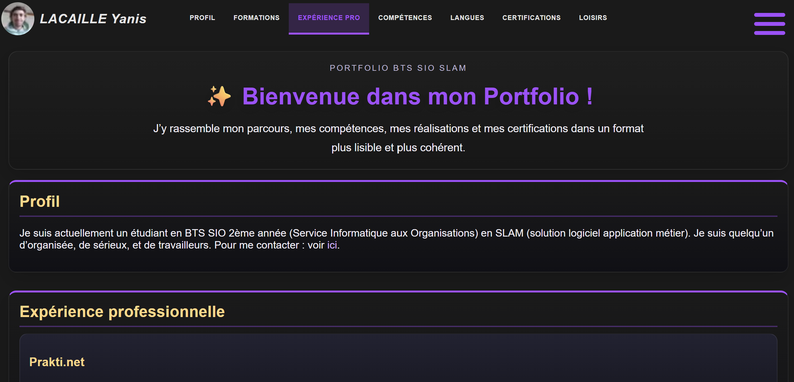

# Yanis LACAILLE – Portfolio

Bienvenue sur mon portfolio personnel construit avec **Astro** 🚀  
Ce site présente mes projets, compétences et expériences.

🔗 [Voir le site en ligne](https://portfolioynsl.netlify.app)

---

## 📸 Aperçu


---

## 🛠 Stack technique

- **Framework** : [Astro](https://astro.build/)
- **Styling** : CSS + Astro
- **Interactivité** : JavaScript
- **Contenu** : Collections Astro + Markdown
- **Hébergement** : [GitHub](https://github.com/) + [Netlify](https://www.netlify.com/)
- **Outils** : Prettier, Visual Studio Code (+ autres d'extensions VSC)

---


## 🚀 Démarrage rapide

### Prérequis

- [Node.js](https://nodejs.org/) (v18+ recommandé)
- [pnpm](https://pnpm.io/) / [npm](https://www.npmjs.com/) / [yarn](https://yarnpkg.com/)

### Installation

```bash
# Cloner le repository
git clone https://github.com/yalac/portfolio.git
cd ton-clone

# Installer les dépendances
pnpm install
# ou npm install / yarn install

# Lancer le serveur de développement
pnpm run dev
# ou npm run dev / yarn dev
```

Le site sera disponible sur `http://localhost:4321`

---


## 📦 Commandes disponibles

| Commande              | Description                                  |
|-----------------------|----------------------------------------------|
| `pnpm run dev`        | Lance le serveur de développement            |
| `pnpm run build`      | Génère le site statique pour la production   |
| `pnpm run preview`    | Prévisualise le build en local               |
| `pnpm run lint`       | Vérifie le code avec ESLint                  |
| `pnpm run format`     | Formate le code avec Prettier                |

---

## 📄 Licence

Ce projet est sous licence **MIT**. Tu es libre de l’utiliser et de le modifier pour ton propre portfolio.

---

## 🤝 Contact

- 📧 Email : [lacailleyanis@gmail.com](mailto:lacailleyanis@gmail.com)
- 💼 LinkedIn : [linkedin.com/in/yanis-la/](https://www.linkedin.com/in/yanis-la/)
- 🐙 GitHub : [github.com/yalac](https://github.com/yalac)

---

<div align="center">

**Fait avec ❤️ et Astro**  
⭐ Si ce projet t’aide, n’hésite pas à laisser une étoile !

</div>
