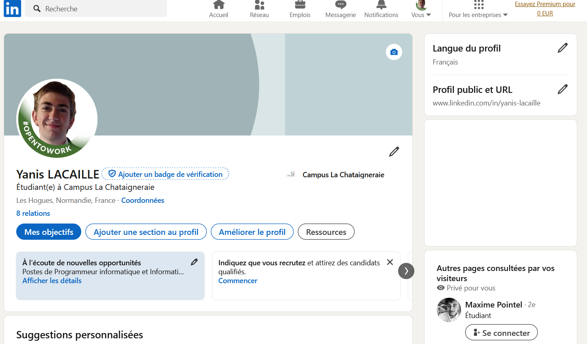

## Contexte

Dans le cadre de mon **_BTS SIO_** au Campus la Châtaigneraie, nous avons dû apprendre à utiliser les réseaux sociaux professionnels tels que LinkedIn afin de me développer pour mes futur projet professionnel et d egérer mon identité numérique.

## Compétences concernéesw

La compétence concernée est

[Organiser son développement professionnel](../listeTP)\
_Gérer son identité professionnelle_\
_Développer son projet professionnel_

## Environnement technologique

Pour ce qui est des réseaux sociaux, j'ai créé un compte LinkedIn. J'ai également installé l'application mobile afin d'y accéder sur mobile et sur PC.

## Preuves

_Mon compte LinkedIn_\

