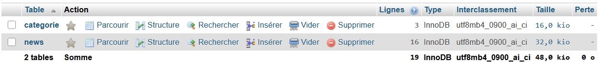
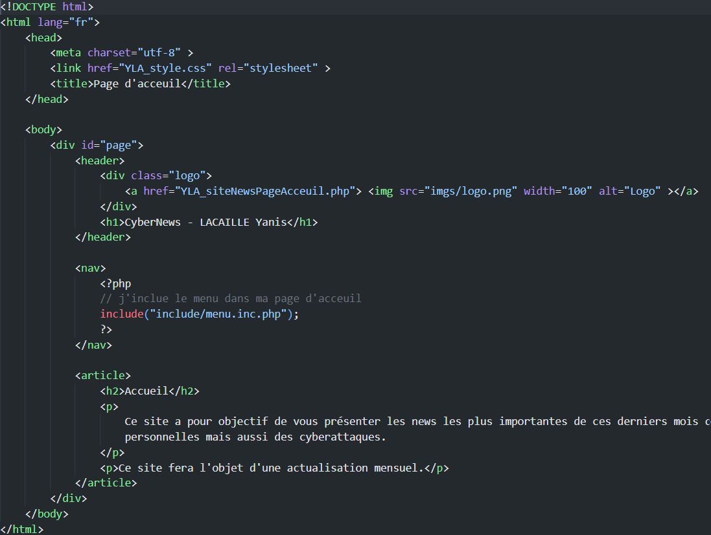
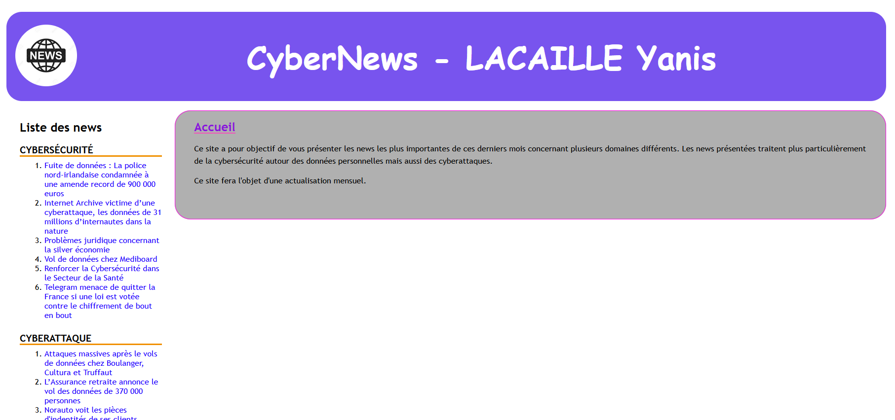

## Contexte

Dans le cadre de mon **_BTS SIO_** au Campus la chataigneraie, nous avons dû réalisé une veille informatique en rapport avec la **cybersécurité**. Pour exploiter cette veille au mieux, nous avons créer un site qui contient toutes les veilles et news que l'ont récupére.

## Compétence concerné

Les compétences concernés sont

[Gérer le patrimoine informatique](../realPro/) (1.2 et 1.4)\
[Développer la précenseen ligne de l'organisation](../realPro/) (3.2)\
[Organiser son développement professionnelles](../realPro/) (6.2)

## Environnement technologique

Pour réaliser ce site, j'ai utilisé plusieurs langages telles que : Php, HTML, CSS, et Sql

## Preuve

Ma première peuve est ma base données faites sur PhpMyAdmin

Ma deuxième preuve concerne le code que j'ai réalisé pour faire ce site

Ma troisème preuve représente le visuel de mon site

