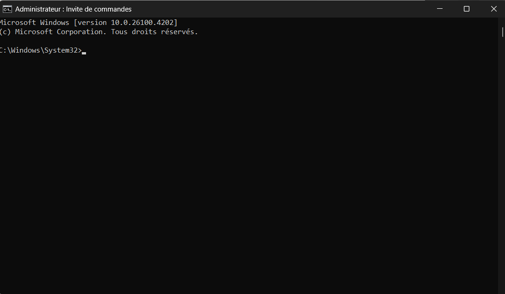
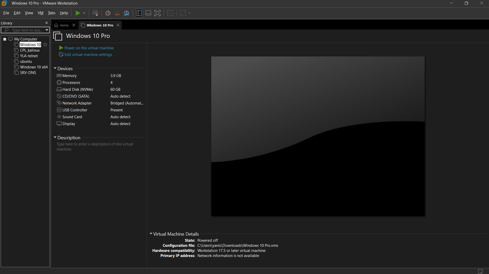
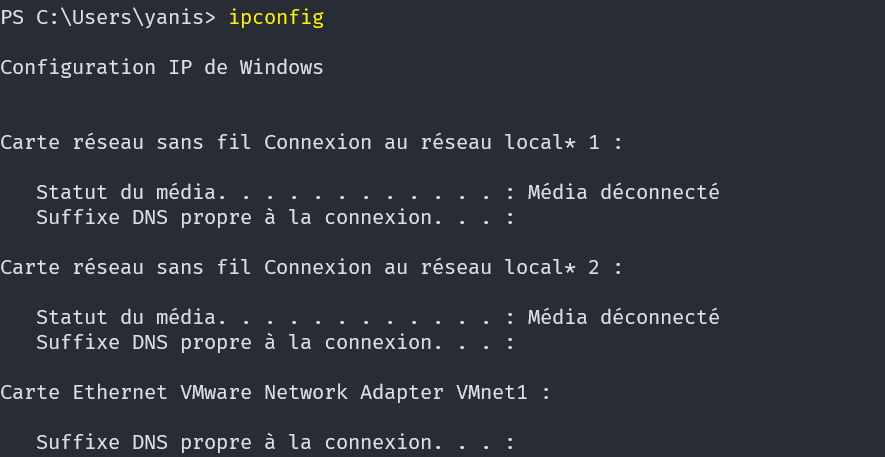

## Contexte

Dans le cadre de mon **_BTS SIO_** au Campus la chataigneraie, nous avons dû apprendre les masques de sous-réseaux ainsi que les différentes IP.

## Compétence concerné

Les compétences concernés sont

[Mettre à disposition des utilisateurs un service informatique](../realPro/) (5.3)

## Environnement technologique

Pour comprendre le fonctionnement des masques de sous-réseaux et l'adressage IP, j'ai utilisé machines virtuelles windows sur VMWare, ainsi que l'invite de commande.

## Preuve

_L'invite de commande_\

_Logiciel VMWare_\

_Exemple de ce que j'ai fait sur l'invite de commande_\

