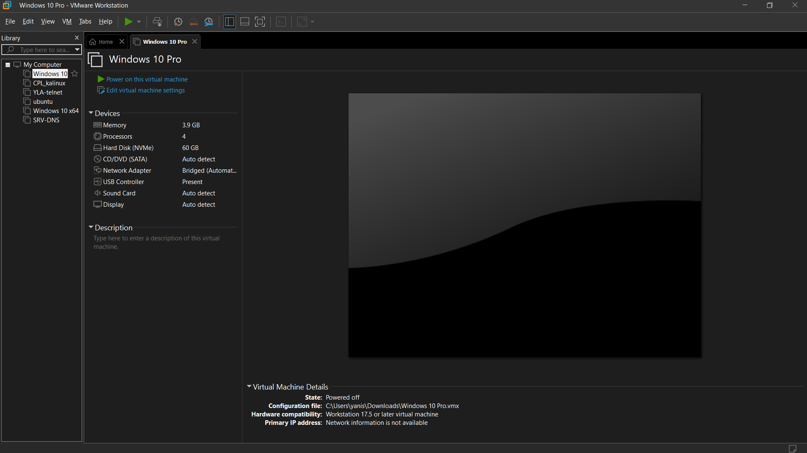
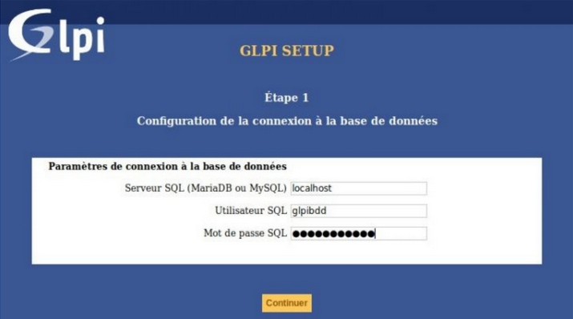

## Contexte

Dans le cadre de mon **_BTS SIO_** au Campus La Châtaigneraie, nous avons dû apprendre à utiliser le logiciel GLPI.

## Compétences concernées

Les compétences concernées sont

[Gérer le patrimoine informatique](../realPro/) (1.2, 1.3, 1.4 et 1.5)\
[Répondre aux incidents et aux demandes d’assistance et d’évolution](../realPro/) (2.1, 2.2 et 2.3)\
[Travailler en mode projet](../realPro/) (4.3)\
[Mettre à disposition des utilisateurs un service informatique](../realPro/) (5.3)

## Environnement technologique

Pour cette réalisation, j'ai utilisé le logiciel GLPI, ainsi qu'une machine virtuelle sous Linux afin d'installer le nécessaire pour GLPI.

## Preuves

_Logiciel VMWare_\

_Logiciel GLPI_\

