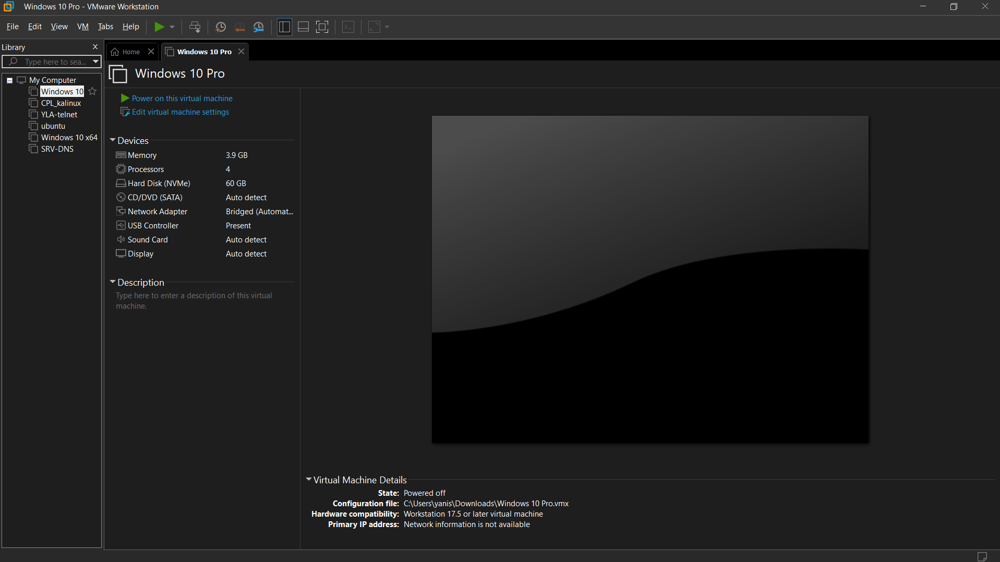
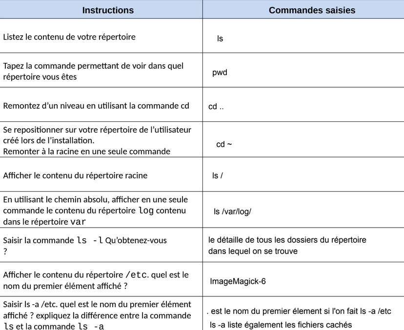

## Contexte

Dans le cadre de mon **_BTS SIO_** au Campus la Châtaigneraie, nous avons dû apprendre à utiliser les commandes Linux et Ubuntu.

## Compétence concernée

Les compétences concernées sont

[Gérer le patrimoine informatique](../realPro/) (1.3 et 1.5)\
[Répondre aux incidents et aux demandes d’assistance et d’évolution](../realPro/) (2.2)

## Environnement technologique

Pour apprendre les commandes de base sur Linux et Ubuntu, j'ai dû installer et utiliser des machines virtuelles afin d'être dans le bon environnement.

## Preuve

_Logiciel VMWare_\

_Liste des commandes Ubuntu de base_\

