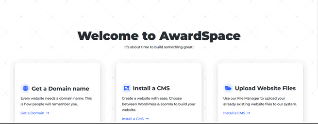

## Contexte

Dans le cadre de mon **_BTS SIO_** au Campus La Châtaigneraie, nous avons dû apprendre à déployer un service.

## Compétence concernée

La compétence concernée est

[Mettre à disposition des utilisateurs un service informatique](/realPro) (5.2)

## Environnement technologique

Pour déployer un site, j'ai appris à utiliser l'hébergeur AwardSpace.

## Preuve

_L'hébergeur AwardSpace_

_Un visuel de ce à quoi ressemble le site_

