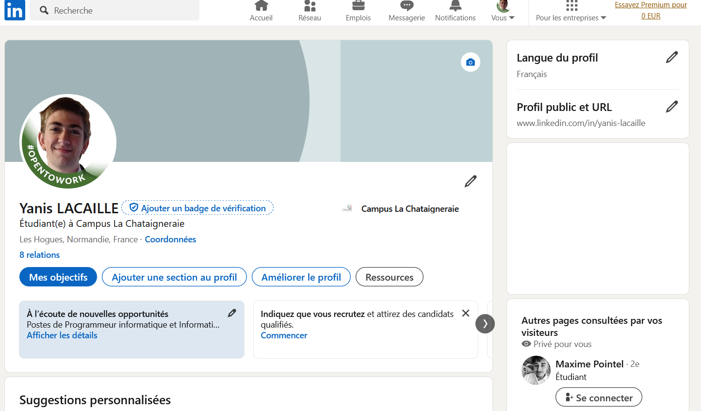

## Contexte

Dans le cadre de mon **_BTS SIO_** au Campus la chataigneraie, nous avons dû apprendre à utilisé les réseaux sociaux professionnelles telle que Linkedln.

## Compétence concerné

Les compétences concernés sont

[Mettre à disposition des utilisateurs un service informatique](../realPro/) (5.2)\
[Organiser son développement professionnel](../realPro/) (6.1, 6.2 et 6.3)

## Environnement technologique

Pour ce qui est des réseaux sociaux, j'ai créer un compte Linkedln. J'ai également installer l'application mobile afin d'y accèder sur mobile et sur PC.

## Preuve

_Mon compte Linkedln_\

