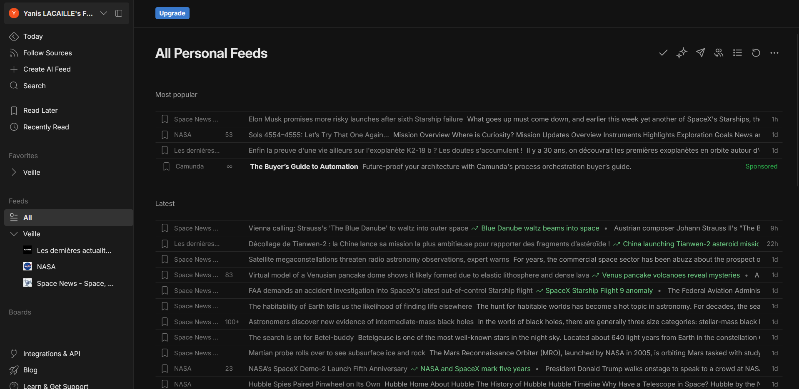
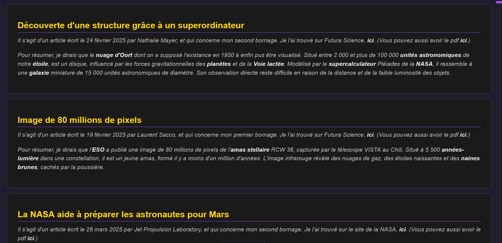

## Contexte

Dans le cadre de mon **_BTS SIO_** au Campus La Châtaigneraie, nous avons dû apprendre à réaliser notre propre veille technologique.

## Compétence concernée

La compétence concernée est

[Organiser son développement professionnel](/realPro) (6.2)

## Environnement technologique

Pour effectuer ma veille technologique, j'ai utilisé plusieurs outils de veille, dont principalement Feedly. De plus, je renseigne tout ici sur mon portfolio.

## Preuves

_Mon outil de veille Feedly_\

_Mon portfolio_\

