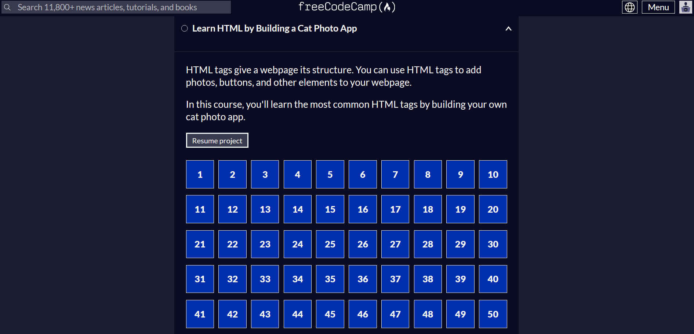

## Contexte

Dans le cadre de mon **_BTS SIO_** au Campus La Châtaigneraie, nous avons une période libre pour obtenir des certifications en lien avec notre spécialité, soit le développement pour moi.

## Compétence concernée

La compétence concernée est

[Organiser son développement professionnel](../realPro/) (6.1)

## Environnement technologique

Pour cette réalisation, il s'agit de notre PC et de sites internet qui proposent des certifications gratuites. J'utilise pour cela le site FreeCodeCamp où je prépare actuellement la certification web qui concerne HTML et CSS.

## Preuve

_Le site FreeCodeCamp_

_La certification que je prépare actuellement_

