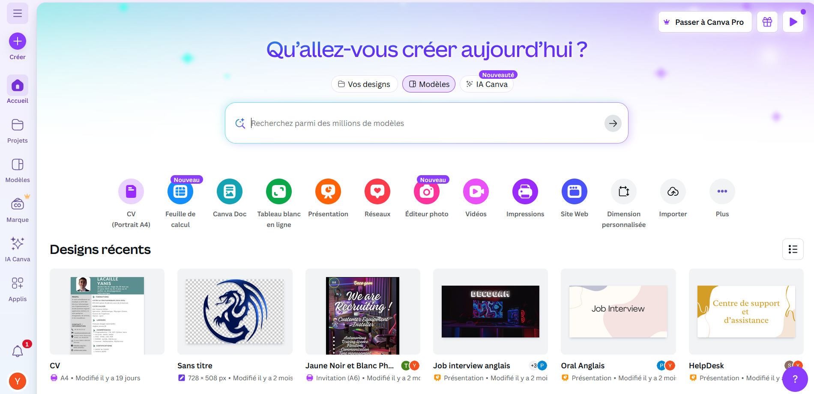
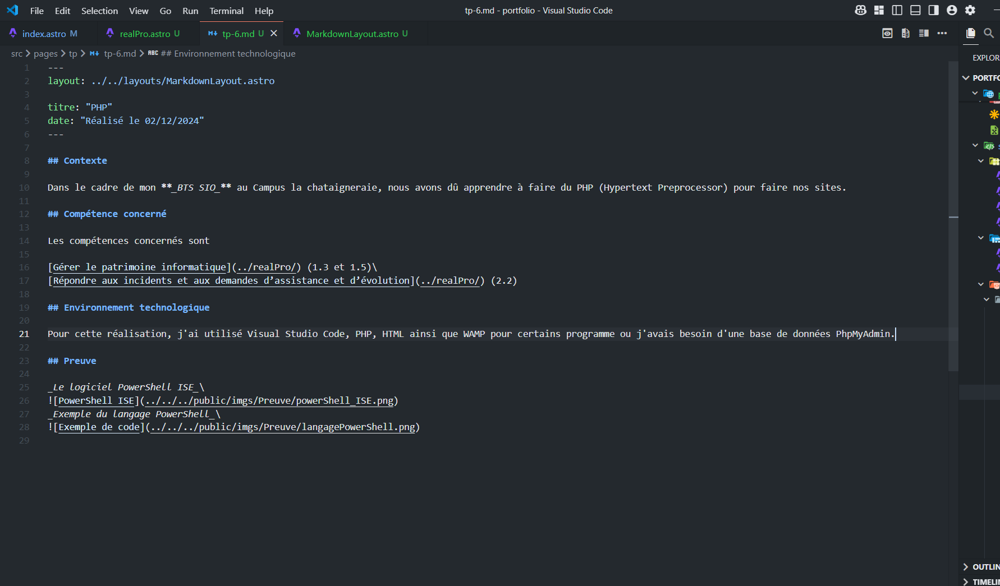
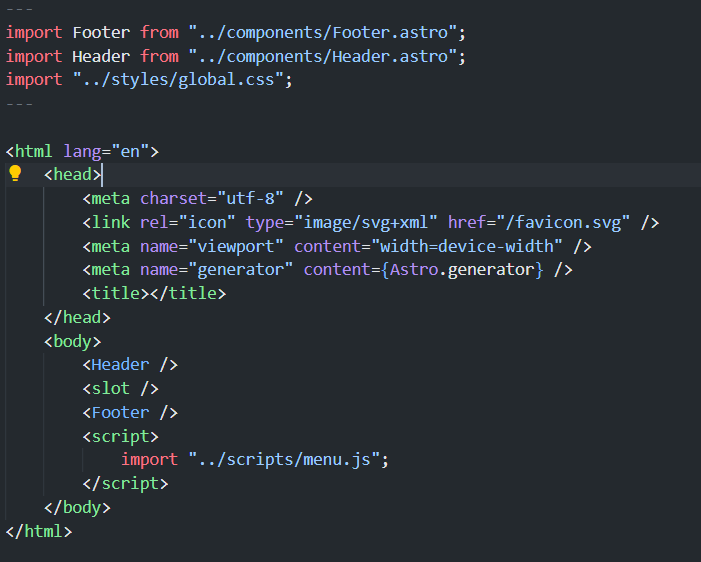

## Contexte

Dans le cadre de mon **_BTS SIO_** au Campus la chataigneraie, nous avons appris à faire un portfolio et un CV professionnelles.

## Compétence concerné

Les compétences concernés sont

[Développer la présence en ligne de l’organisation](../realPro/) (3.3)\
[Mettre à disposition des utilisateurs un service informatique](../realPro/) (5.2)\
[Organiser son développement professionnel](../realPro/) (6.3 et 6.4)

## Environnement technologique

Pour réaliser mon CV et mon portfolio, j'ai utilisé Canva pour mon CV et le langage de programmation astro qui est un mélange de HTML, de JavaScript, et de Markdown. J'utilise Visual Studio Code pour programmer.

## Preuve

_Le site Canva_\

_Le logiciel Visual Studio Code_\

_Exemple du langage Astro_\

