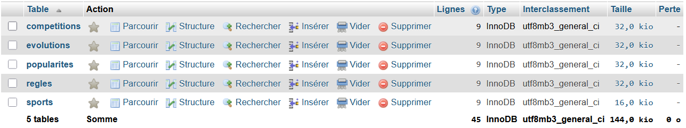
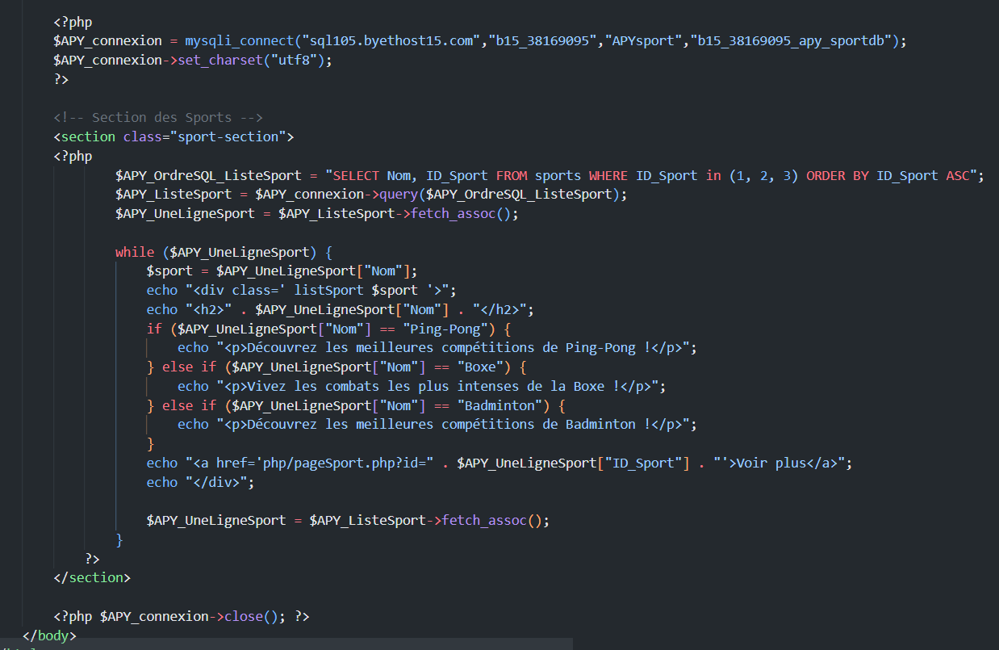
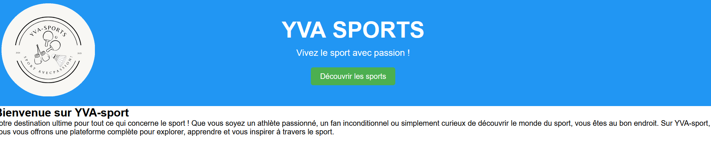

## Contexte

Dans le cadre de mon **_BTS SIO_** au Campus la Châtaigneraie, nous avons dû réaliser un site en équipe pour tester nos connaissances et compétences acquises jusque-là.

## Compétences concernées

Les compétences concernées sont

[Gérer le patrimoine informatique](../realPro) (1.2 et 1.4)\
[Travailler en mode projet](../realPro) (4.1, 4.2 et 4.3)\
[Mettre à disposition des utilisateurs un service informatique](../realPro) (5.2)

## Environnement technologique

Pour réaliser ce site, j'ai utilisé plusieurs langages tels que : PHP, HTML, CSS et SQL.

## Preuves

_Ma première preuve est ma base de données créée sur PhpMyAdmin_

_Ma deuxième preuve concerne le code que j'ai réalisé pour ce site_

_Ma troisième preuve représente le visuel de mon site_

