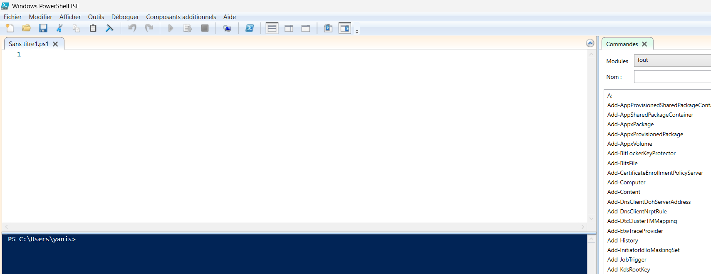
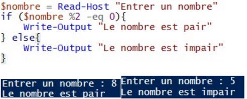

## Contexte

Dans le cadre de mon **_BTS SIO_** au Campus la chataigneraie, nous avons dû apprendre à utilisé PowerShell.

## Compétence concerné

Les compétences concernés sont

[Gérer le patrimoine informatique](../realPro/) (1.3 et 1.5)\
[Répondre aux incidents et aux demandes d’assistance et d’évolution](../realPro/) (2.2)

## Environnement technologique

Pour farie cette réalisations, j'ai utilisé PowerShell ISE, et PowerShell un langage de script.

## Preuve

_Le logiciel PowerShell ISE_\

_Exemple du langage PowerShell_\

