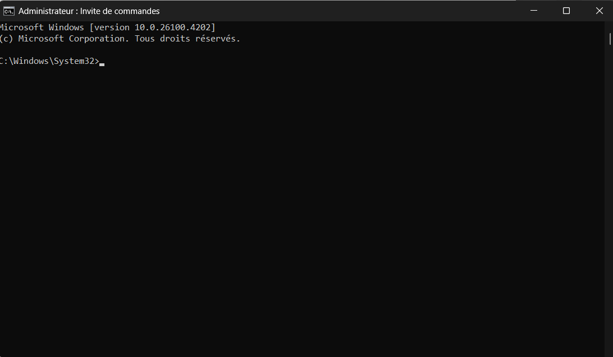
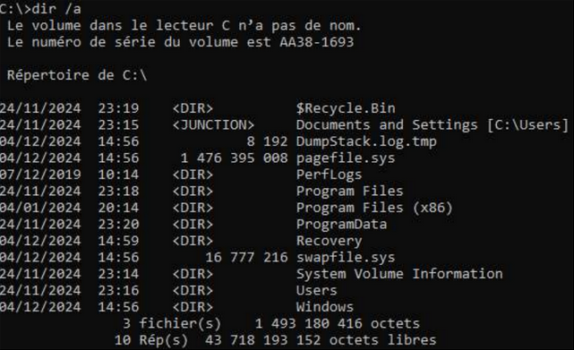

## Contexte

Dans le cadre de mon **_BTS SIO_** au Campus La Châtaigneraie, nous avons dû apprendre à utiliser MS-DOS.

## Compétences concernées

Les compétences concernées sont

[Gérer le patrimoine informatique](../realPro/) (1.3 et 1.5)\
[Répondre aux incidents et aux demandes d’assistance et d’évolution](../realPro/) (2.2)

## Environnement technologique

Pour cette réalisation, j'ai utilisé l'invite de commandes et MS-DOS, le langage que l'on utilise avec le CMD (invite de commandes).

## Preuves

_L'invite de commandes_\

_Exemple de ce que l'on peut faire en MS-DOS_\

