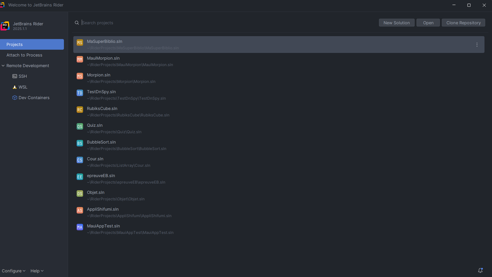
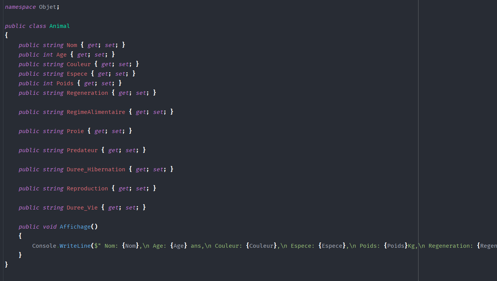

## Contexte

Dans le cadre de mon **_BTS SIO_** au Campus la chataigneraie, nous avons dû apprendre à faire du C#. Pour cela nous avons vu plusieurs notion importantes dont les méthodes.

## Compétence concerné

Les compétences concernés sont

[Gérer le patrimoine informatique](../realPro/) (1.2, 1.3 et 1.5)\
[Répondre aux incidents et aux demandes d’assistance et d’évolution](../realPro/) (2.3)\
[Développer la présence en ligne de l’organisation](../realPro/) (3.3)\
[Mettre à disposition des utilisateurs un service informatique](../realPro/) (5.2)

## Environnement technologique

Pour cette réalisation, j'ai utilisé Rider et le langage C# pour programmer.

## Preuve

_Le logiciel Rider_\

_Exemple du langage C#_\

