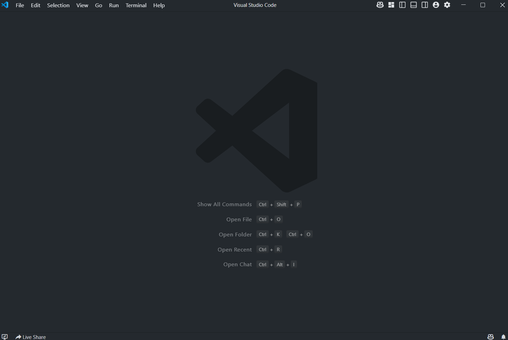
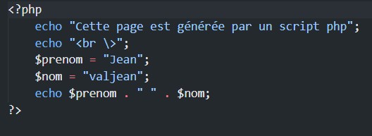

## Contexte

Dans le cadre de mon **_BTS SIO_** au Campus La Châtaigneraie, nous avons dû apprendre à utiliser PHP (Hypertext Preprocessor) pour développer nos sites.

## Compétences concernées

Les compétences concernées sont

[Gérer le patrimoine informatique](../realPro/) (1.2)\
[Développer la présence en ligne de l’organisation](../realPro/) (3.3)

## Environnement technologique

Pour cette réalisation, j'ai utilisé Visual Studio Code, PHP, HTML ainsi que WAMP pour certains programmes où j'avais besoin d'une base de données PhpMyAdmin.

## Preuves

_Le logiciel Visual Studio Code_\

_Exemple du langage PHP (HyperText Preprocessor)_\

