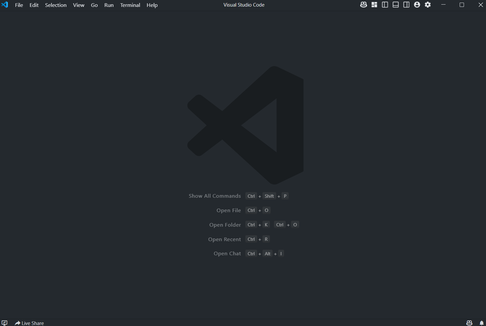
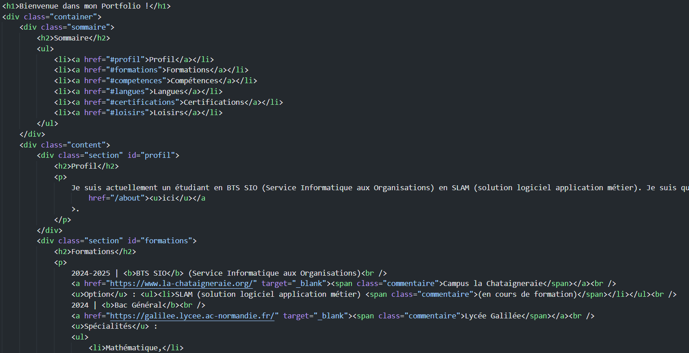

## Contexte

Dans le cadre de mon **_BTS SIO_** au Campus La Châtaigneraie, nous avons dû apprendre à utiliser le HTML (Hypertext Markup Language) pour créer nos sites.

## Compétence concernée

La compétence concernée est

[Développer la présence en ligne de l’organisation](../realPro/) (3.3)

## Environnement technologique

Pour cette réalisation, j'ai utilisé le logiciel Visual Studio Code, ainsi que le langage HTML (Hypertext Markup Language).

## Preuves

_Le logiciel Visual Studio Code_

_Exemple du langage HTML_

