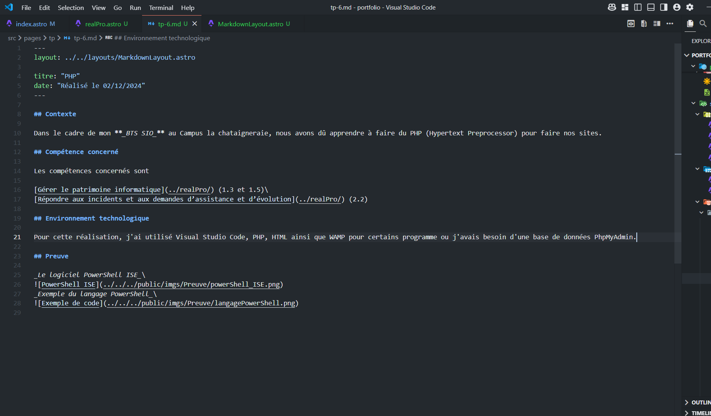
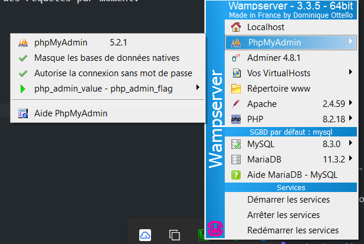
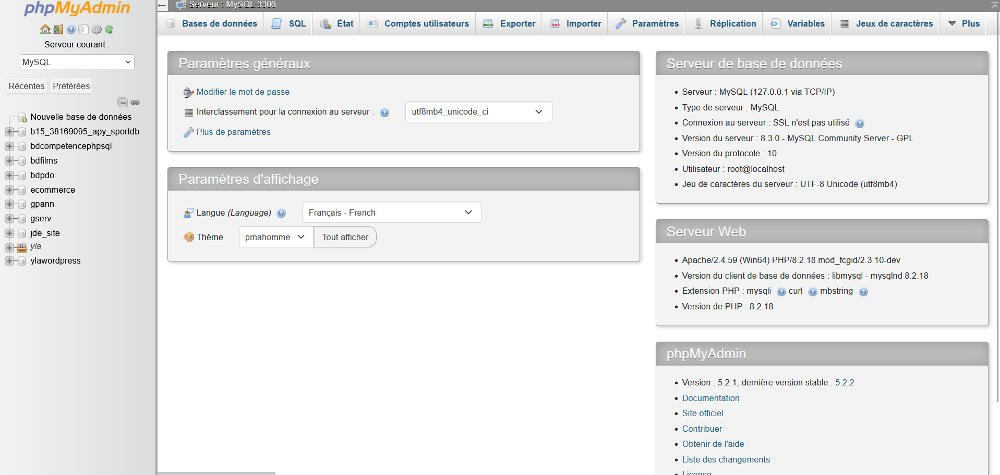
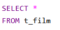

## Contexte

Dans le cadre de mon **_BTS SIO_** au Campus La Châtaigneraie, nous avons dû apprendre à faire du SQL et à gérer des bases de données.

## Compétence concernée

La compétence concernée est

[Développer la présence en ligne de l’organisation](/realPro) (3.3)

## Environnement technologique

Pour créer des bases de données et effectuer des requêtes SQL, j'ai utilisé PhpMyAdmin avec WAMP, ainsi que Visual Studio Code pour rédiger des requêtes à certains moments.

## Preuves

_Le logiciel Visual Studio Code_\

_Logiciel WAMP_\

_Application PhpMyAdmin_\

_Exemple de requêtes SQL_\

