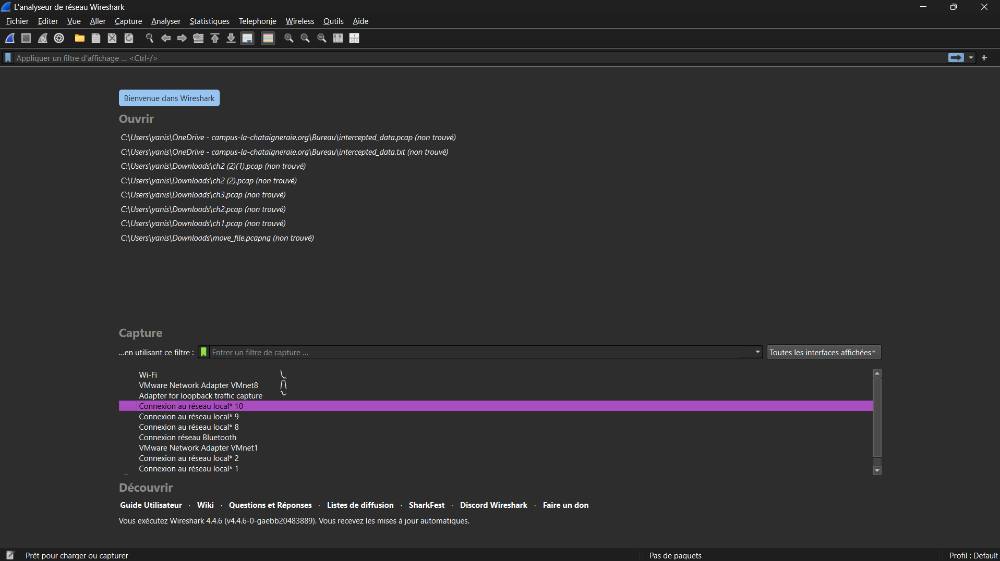
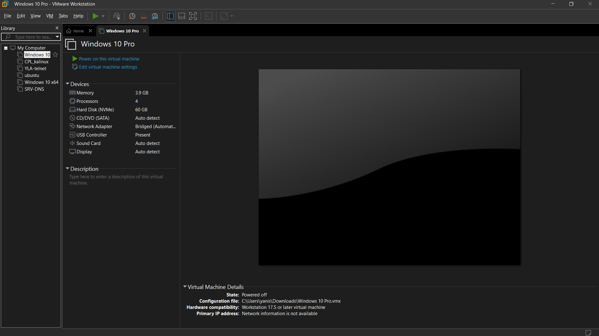

## Contexte

Dans le cadre de mon **_BTS SIO_** au Campus la Châtaigneraie, nous avons dû apprendre les différentes couches d'un réseau, dont le modèle OSI.

## Compétence concernée

Les compétences concernées sont

[Mettre à disposition des utilisateurs un service informatique](/realPro) (5.1 et 5.2)

## Environnement technologique

Pour comprendre le fonctionnement des réseaux ainsi que le modèle OSI, j'ai utilisé le logiciel WireShark, des machines virtuelles Windows sur VMWare, et des sites internet qui permettent de comprendre certains aspects des IP.

## Preuves

_Le logiciel WireShark_\

_Logiciel VMWare_\

_Exemple d'une trame WireShark_\

