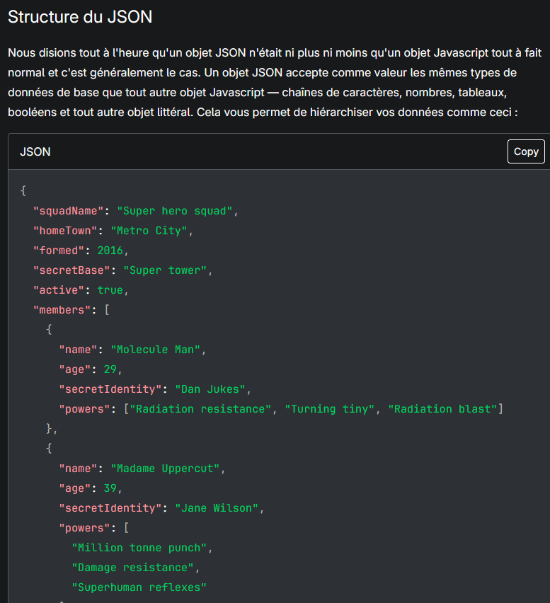
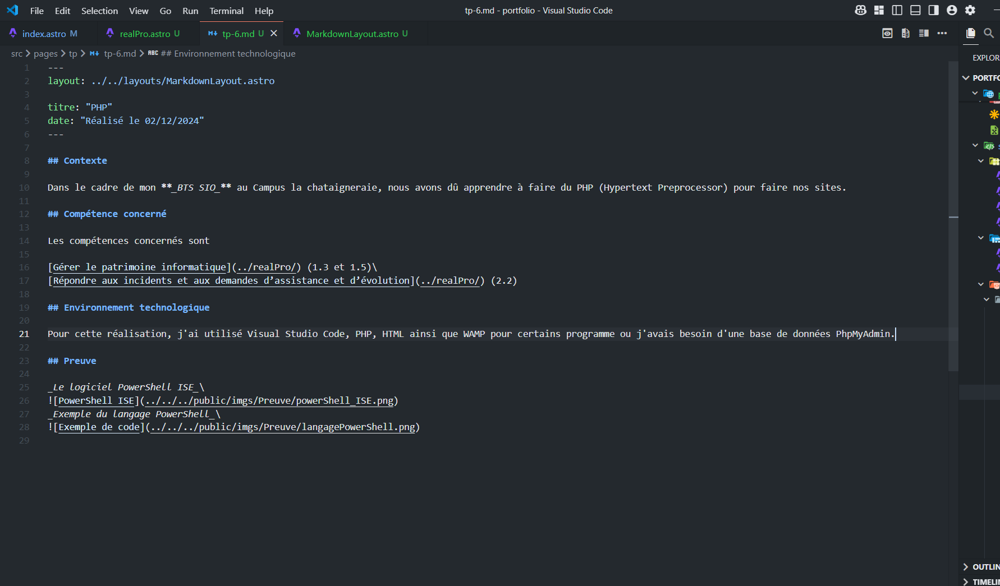
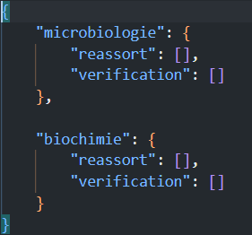
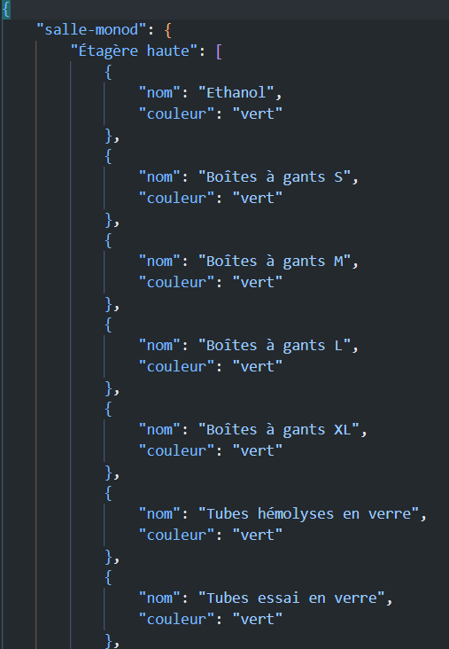

## Contexte

Dans le cadre de mon **_stage au Lycée Galilée_**, j'ai dû apprendre le JSON pour réaliser le site demandé.

## Compétence concernée

La compétence concernée est

[Développer la présence en ligne de l’organisation](/realPro) (3.3)

## Environnement technologique

Pour apprendre le JSON, j'ai utilisé Visual Studio Code ainsi que des sites internet tels que MDN Web Docs afin de me renseigner.

## Preuve

_MDN Web Docs_

_Le logiciel Visual Studio Code_

_Deux exemples du code JSON utilisé_

